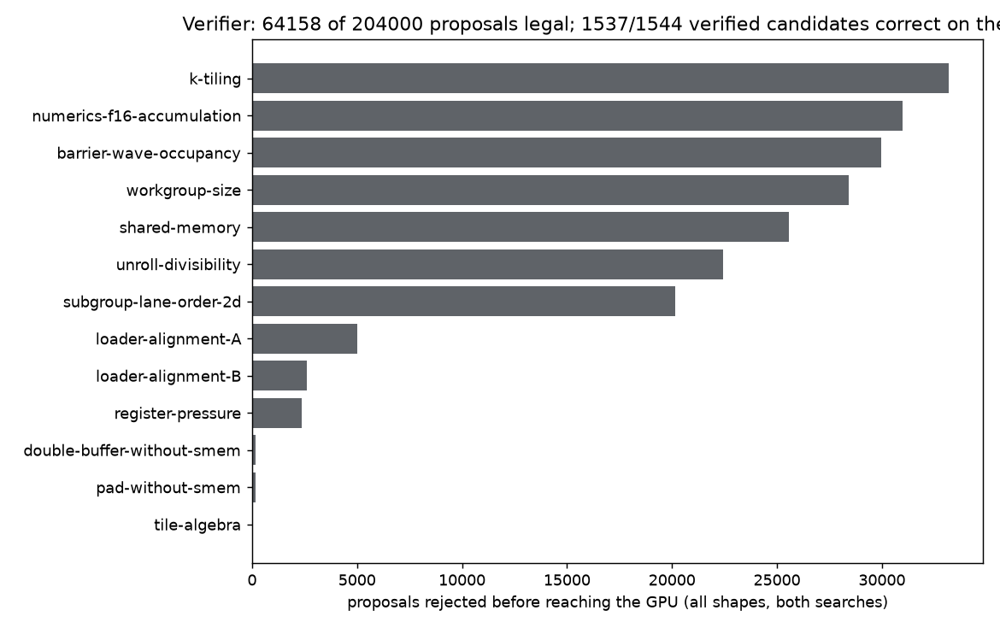
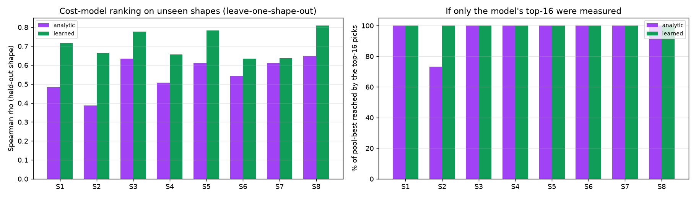
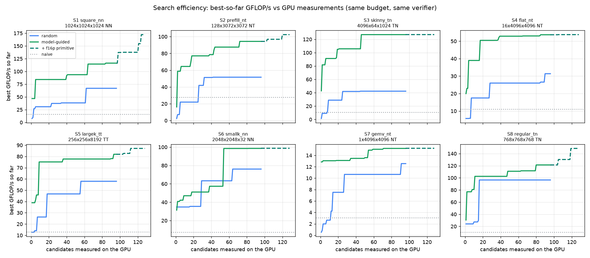
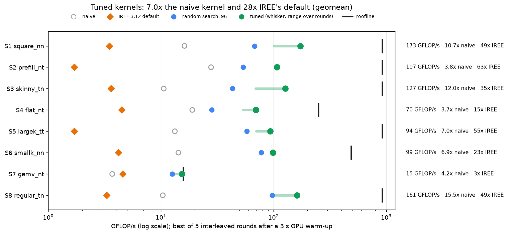
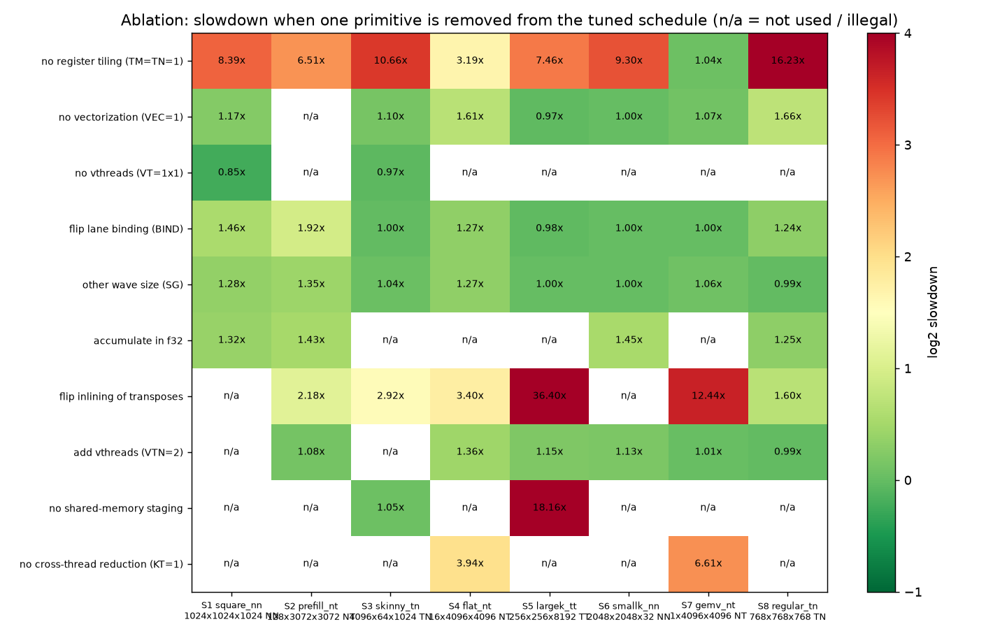

# Tuning fp16 GEMMs on a Phone GPU: Schedules, a Verifier and a Cost Model

*Part 2 of [Bringing PyTorch LLMs to a Mid-Range Adreno GPU with IREE](BLOG.md) · October 12, 2026 · Aditya*

## TL;DR

I tuned eight fp16 GEMMs for the Adreno 710 GPU in a mid-range phone. The tuned kernels run 7.0x faster than a naive kernel and 28x faster than IREE 3.12's default kernels (geometric mean). The batch-1 GEMV reaches 97.5% of the DRAM roofline.

The tuner is a TVM-style schedule space lowered to GLSL. It covers cross-thread reduction, multi-level tiling, vectorization, inlining or materializing transposes, thread bindings and vthreads, plus shared-memory staging, double buffering and promoted fp16 accumulation. A verifier gates every candidate before it reaches the GPU, and a cost model ranks what is worth measuring:

- **Search:** with the same budget of 96 GPU measurements per shape, model-guided search beats random search on every shape, with 1.9x faster kernels at the geometric mean. It matches random search's final best after a median of 4.5 measurements.
- **Verifier:** 1,537 of 1,544 verified candidates were correct on the GPU. Its rules come from device limits, from Mesa's compiler source, and from failures measured on the phone.
- **Cost model:** on shapes it has never seen, the learned model ranks candidates with Spearman rho 0.71, against 0.55 for the analytic roofline model.

Three lessons carried the most weight:

1. **Encode the driver, not the spec.** Four verifier rules came from GPU failures: Turnip exits on barrier workgroups it cannot keep resident, and clustered subgroup adds are wrong in 2-D workgroups. Neither appears in a Vulkan limit.
2. **Model the real compiler's occupancy.** Adding Mesa ir3's wave-residency rules and the lane order of rfactor raised the analytic model's rank correlation from 0.43 to 0.62.
3. **Measure like it is a phone.** GPU clock scaling made the first kernel of every batch 1.6 to 1.9x slow. Warm-up, interleaved rounds and best-of-rounds fixed the comparisons.

The code companion is the [`gemm/`](gemm/) package of this repo. Every bug found on the way is linked at the end.

## The problem: eight GEMMs that stress different things

One tuner has to handle all eight. Each is fp16 in and fp16 out, with C = op(A) · op(B). Layout letters follow BLAS: `N` means stored as written, `T` means stored transposed. A PyTorch `Linear` weight is `B` in `T` layout.

| id | name | M x N x K | layout | what it stresses |
| --- | --- | --- | --- | --- |
| S1 | square_nn | 1024 x 1024 x 1024 | NN | the textbook case: compute-bound tiling |
| S2 | prefill_nt | 128 x 3072 x 3072 | NT | LLM prefill: 128 tokens through `Linear(3072, 3072)` |
| S3 | skinny_tn | 4096 x 64 x 1024 | TN | tall-skinny output, transposed A |
| S4 | flat_nt | 16 x 4096 x 4096 | NT | short-wide: batch-16 decode, weight-bandwidth bound |
| S5 | largek_tt | 256 x 256 x 8192 | TT | large K: few outputs, long reductions, both operands transposed |
| S6 | smallk_nn | 2048 x 2048 x 32 | NN | small K: output-write bound |
| S7 | gemv_nt | 1 x 4096 x 4096 | NT | matrix-vector: batch-1 decode |
| S8 | regular_tn | 768 x 768 x 768 | TN | regular size, transposed A |

Everything runs from a Mac. The phone is the Adreno 710 with the Mesa Turnip driver from Part 1, reached over adb on Wi-Fi.

## Step 1: Install two packages on top of Part 1

Part 1 already set up the NDK, adb, Mesa Turnip on the phone and two Python environments. The GEMM tuner adds a learned cost model and charts. Both packages are in [`scripts/setup_venvs.sh`](scripts/setup_venvs.sh) and listed in [`docs/SETUP.md`](docs/SETUP.md):

```bash
uv pip install --python .venv-iree312/bin/python scikit-learn==1.9.1   # + scipy 1.18.1
uv pip install --python .venv-iree312/bin/python matplotlib==3.11.2
```

The phone is reached over adb on Wi-Fi only. [`gemm/device.py`](gemm/device.py) pins every call to that transport. On a failure it reconnects over Wi-Fi instead of falling back to USB:

```python
WIFI = os.environ.get("ADB_WIFI", "192.168.1.7:5555")
os.environ["ANDROID_SERIAL"] = WIFI  # pin every adb call to the Wi-Fi transport

def reconnect():
    subprocess.run(["adb", "connect", WIFI], capture_output=True, text=True, timeout=20)
```

Exit status 255 is adb's own, never the harness's. A dropped transport therefore reruns the rest of the batch without blaming a kernel.

## Step 2: The first end-to-end path, one GEMM from Python to the GPU

The loop has four stages. Generate GLSL on the Mac, compile it to SPIR-V with the NDK's `glslc`, push it over adb, and run it in a small Vulkan harness on the phone that checks the answer and times it. A whole batch of candidates shares one adb round trip.

The harness, [`gemm/harness/vk_gemm_bench.c`](gemm/harness/vk_gemm_bench.c), is 490 lines of C. It reads a manifest with one candidate per line: name, shape directory, subgroup size, then each dispatch as `spv[@entry] gx gy gz`. Every candidate must reproduce a float32 reference computed by numpy before it is timed. C is poisoned with NaNs first, so an element nobody wrote cannot pass:

```c
// Correctness: poison C, run once, compare with the reference.
memset(s->b[2].map, 0xFF, s->b[2].size);  // f16 NaNs
CHECK(record(c, s, k, p, 1, 0));
for (size_t i = 0; i < n; ++i) {
  double e = fabs(half_to_float(C[i]) - s->cref[i]);
  if (!(e == e)) { maxerr = INFINITY; break; }  // NaN
  if (e > maxerr) maxerr = e;
}
err = maxerr / maxref;
ok = err <= s->tol;  // 5e-3; fp16 output rounding alone is ~5e-4
```

Timing uses GPU timestamps around enough back-to-back dispatches to fill about 25 ms. It reports the median and the fastest of 5 repetitions, as one JSON line per candidate:

```json
{"name":"S4_abl2_3","ok":true,"err":7.322e-04,"us":9990.000,"us_min":9983.281,"iters":3,"reps":5}
```

On the Mac side, measuring a schedule is one call. `naive(s)` is the textbook kernel: one output per thread, 8 x 8 threads per workgroup, no shared memory.

```python
from search import measure, naive
res = measure(s, [naive(s)], out_dir, "naive", "turnip", log, meta)  # {sched.key(): microseconds}
```

### Measure the roofline before tuning

Spec-sheet peaks are no use here, so [`gemm/roofline.py`](gemm/roofline.py) measures them through the same harness. The FMA probe needed tuning of its own. Eight or more independent FMA chains *lose* throughput to register pressure; four chains unrolled four times reach the peak.

```python
FMA_VARIANTS = [(4, 4), (8, 4), (8, 1), (16, 1)]  # (independent chains, unroll): ILP vs occupancy
body = "\n".join([f"    v{i} = fma(v{i}, a, b);" for i in range(chains)] * unroll)
```

| measured on the Adreno 710 (Turnip) | value |
| --- | --- |
| fp16 FMA peak | 920.8 GFLOP/s |
| fp32 FMA peak | 368.4 GFLOP/s |
| DRAM read bandwidth | 15.8 GB/s |
| DRAM copy bandwidth | 14.4 GB/s |

A shape's roofline is `min(peak, FLOPs / compulsory bytes x 15.8 GB/s)`. S7, the GEMV, can do at most 15.8 GFLOP/s however good the kernel. S4 is capped at 251 GFLOP/s and S6 at 490 GFLOP/s.

## Step 3: The schedule space, TVM primitives lowered to GLSL

A candidate is a `Schedule`, one point in a TVM/Ansor-style space ([`gemm/schedule.py`](gemm/schedule.py)). Each knob is one scheduling primitive applied to `for m, n: for k: C[m, n] += op(A)[m, k] * op(B)[k, n]`:

```python
@dataclasses.dataclass(frozen=True)
class Schedule:
    BM: int; BN: int; BK: int         # multi-level tiling: workgroup tile and k tile
    TM: int; TN: int                  #                     per-thread register tile
    VTM: int = 1; VTN: int = 1        # vthreads: a thread's tile split into strided sub-tiles
    KT: int = 1                       # rfactor: k split across KT lanes ...
    RED: str = "subgroup"             # ... combined by a clustered subgroup add or via shared memory
    KMAP: str = "block"               # contiguous or interleaved k slices per rfactor lane
    SMEM_A: int = 0; SMEM_B: int = 0  # cache_read into shared memory
    DB: int = 0                       # double buffering (prefetch the next k tile into registers)
    VEC: int = 1                      # vectorize global loads and stores
    PAD: int = 0                      # shared-memory padding (bank conflicts)
    UNROLL: int = 1                   # unroll the k loop
    ACC: str = "f32"                  # accumulate: f32 | f16 | f16p (promoted, see Results)
    INLINE_A: int = 1; INLINE_B: int = 1  # compute_inline a transposed operand, or materialize it
    BIND: str = "n"                   # which output axis the fastest lanes walk
    SG: int = 64                      # hardware wave size (64 | 128)
```

`schedule_text` prints any point as TVM-style schedule code, so tuned results stay readable. One for S2:

```python
# S2 prefill_nt: C[128,3072] = A[...] @ Bᵀ[...], K=3072
s[B_T].compute_inline()
mo, mi = s[C].split(m, 8); no, ni = s[C].split(n, 64)
mt, mr = s[C].split(mi, 2); nt, nr = s[C].split(ni, 4)
bind(mo, 'workgroup.y'); bind(no, 'workgroup.x')
bind(nt, 'thread.fastest'); subgroup_size(64)
vthread(nr, 2)  # strided ownership, stride BN/2
ko, ki = s[C].split(k, 32)
kr, kl = s[C].split(ki, nparts=4); CF = s.rfactor(C, kr); bind(kr, 'thread.reduce'); allreduce('subgroup')
vectorize(loads: k=4); vectorize(store, 2)
accumulate('f32')
```

The code generator turns that into one GLSL compute shader, plus one transpose kernel per operand that is materialized rather than inlined. Each of the five primitives the brief asked for shows up as a concrete piece of generated code. The fragments below are from the S2 schedule above.

**1. Cross-thread reduction (rfactor).** `KT` lanes split each thread's k range, then combine with one clustered subgroup add per accumulator. With `RED="smem"` the partials go through a shared array and lane 0 sums them instead.

```glsl
uint kt = tid % 4u; uint t = tid / 4u;   // rfactor lanes are the fastest-varying lanes
...
c_0_0 = subgroupClusteredAdd(c_0_0, 4u);
if (kt != 0u) return;                      // lane 0 of each cluster owns the output
```

This primitive makes the skinny, flat, large-K and GEMV shapes work. It also makes fp16 accumulation legal on long K, because each lane's sequential chain is only K/KT long.

**2. Multi-level tiling.** Workgroup tile `BM x BN`, a `TM x TN` thread tile held in registers, and a `BK` k tile. A 2 x 4 register tile reuses each loaded A value 4 times and each B value twice.

```glsl
c_0_0 = fma(float(a0.x), float(b0.x), c_0_0);
c_0_1 = fma(float(a0.x), float(b1.x), c_0_1);   // a0 reused across the thread's 4 columns
```

**3. Vectorization.** `VEC` sets the width of global loads along each operand's contiguous axis, and of the C stores.

```glsl
f16vec4 a0 = A_v4[(ao0 + k0 + (kt * 8u + (kc + 0u) * 4u + 0u)) >> 2];
C_v2[(cm * N + (n0 + (0u + tx * 2u))) >> 1] = f16vec2(float16_t(c_0_0), float16_t(c_0_1));
```

For an operand staged in shared memory, the loader is shaped so that every shared write is a whole vector. A thread loads `sv` rows by `vw` k values, transposes them in registers, and writes `vw` vectors of `sv` lanes. Writing single lanes of a shared `f16vec4` races between threads; see the fixes at the end.

```python
ux, uk = (max(vw, sv), 1) if contig_x else (sv, vw)   # loader unit: ux along m/n by uk along k
```

**4. Inlining.** A transposed operand is either inlined, with its indices swapped at load time, or materialized by a separate transpose kernel first, so the GEMM reads it in `N` layout.

```python
if s.lb == "T" and not sc.INLINE_B:  # Bᵀ stored [N][K] -> S1 [K][N]
    out.append(("transB", transpose_glsl(s.N, s.K, 1, 4), (-(-s.K // 16), -(-s.N // 16), 1)))
```

Inlining saves a launch and a round trip of the operand through DRAM. Materializing turns strided reads into coalesced ones. Which wins depends on the shape, so it is a search knob.

**5. Thread bindings and vthreads.** `BIND` picks the output axis the fastest lanes walk, and `SG` picks wave64 or wave128. `VTM x VTN` splits a thread's tile into sub-tiles placed `BM/VTM` and `BN/VTN` apart, so neighbouring threads touch neighbouring addresses. The ownership algebra lives in one place, shared by the code generator, the verifier and the cost model:

```python
def cols(sc, tx):  # local columns owned by thread column tx
    return [v * (sc.BN // sc.VTN) + tx * sc.SN + c for v in range(sc.VTN) for c in range(sc.SN)]

def thread_xy(sc, tid):
    kt, t = tid % sc.KT, tid // sc.KT
    return (t % sc.WX, t // sc.WX, kt) if sc.BIND == "n" else (t // sc.WY, t % sc.WY, kt)
```

## Step 4: The verifier keeps illegal kernels off the GPU

Of 1,544 verified candidates in the main tuning run, 1,537 were correct on the GPU (99.5%). The continuation run went 256 of 256. On a phone, a bad kernel can hang the GPU (`VK_ERROR_DEVICE_LOST`), make the driver call `exit(1)`, or return plausible wrong numbers. Every candidate passes [`gemm/verifier.py`](gemm/verifier.py) before compilation, in three stages, cheapest first.

**Stage 1, static rules.** Each rule has a reason code. Each comes from a device limit, the driver's source, or a failure measured on the GPU.

| rule | where it comes from |
| --- | --- |
| `workgroup-size`, `shared-memory`, `grid-size`, `subgroup-size-unsupported` | device limits from `vkinfo`: 2048 invocations, 32 KB shared memory, wave64 and wave128 |
| `no-clustered-subgroup-ops`, `cluster-size` | driver features: the vendor driver lacks clustered subgroup ops |
| `barrier-wave-occupancy` | Mesa's ir3 source: a workgroup with a barrier must fit in 16 resident waves, allocated in pairs, or the driver calls `exit(1)` |
| `barrier-wave-occupancy-kt2` | measured: at exactly 16 waves, 2-lane subgroup clusters made the driver exit 5 of 5 times |
| `subgroup-lane-order-2d` | measured: clustered adds in workgroups above 1024 threads return wrong sums |
| `numerics-f16-accumulation` | measured: fp16 chains longer than 256 exceed the 5e-3 tolerance |
| `register-pressure` | estimated live registers (accumulators, fragments, prefetch) above 128 |
| tiling algebra, loader alignment, unroll divisibility, padding or double buffering without shared memory | legality of the schedule itself |

The fp16 rule came straight from data. The first tuning run plotted error against each lane's sequential chain length K/KT:

| K / KT | max relative error | over the 5e-3 tolerance |
| --- | --- | --- |
| 256 or less | 4.0e-3 | 0 of 59 |
| 512 | 7.0e-3 | 8 of 8 |
| 1024 | 1.07e-2 | 12 of 12 |

```python
if sc.ACC == "f16" and s.K // sc.KT > F16_ACC_MAX_CHAIN:       # 256
    v.append("numerics-f16-accumulation")
has_barrier = sc.SMEM_A or sc.SMEM_B or (sc.KT > 1 and sc.RED == "smem")
waves = -(-sc.WGS // (sc.SG * g)) * g                        # waves come in pairs (g = 2)
if has_barrier and waves > d["max_waves"]:                   # 16 on FD710 (Mesa freedreno_devices.py)
    v.append("barrier-wave-occupancy")
```

**Stage 2, mapping check.** The verifier replays the schedule's index algebra with the same `rows`, `cols`, `kslice` and `loader_unit` helpers the code generator uses. It proves four things:

- every output of a workgroup is owned exactly once;
- every k is reduced exactly once;
- boundary rows and columns are guarded;
- every shared tile element is loaded exactly once, as part of a whole vector.

```python
for tid in range(sc.WGS):
    tx, ty, kt = thread_xy(sc, tid)
    if kt == 0:
        for r in rows(sc, ty):
            for c in cols(sc, tx):
                owned[(r, c)] += 1
if len(owned) != sc.BM * sc.BN or any(n != 1 for n in owned.values()):
    v.append("output-coverage")
```

**Stage 3, compile.** `glslc` and SPIR-V validation run in parallel threads right before measurement. The SPIR-V cache is written atomically, because two candidates can share a transpose kernel.

The rule set grew out of failures. Before tuning, a correctness fuzz runs random verified schedules on all eight shapes, and every one must match the reference. The first fuzz of the current code generator passed only 35 of 94. Each failure traced to a code-generator bug or a missing rule, and two fresh fuzzes then passed 137 of 142 and 141 of 142. The seven failures left in the tuning run were three slow tiny-workgroup kernels that tripped the GPU watchdog, three driver exits that produced the KT=2 rule, and one fp16 chain of exactly 256 that missed tolerance by 5%.



## Step 5: The cost model ranks candidates before the GPU sees them

Each search round proposes 3,000 schedules. The verifier keeps about a third, and the cost model ([`gemm/cost_model.py`](gemm/cost_model.py)) picks the 16 that get measured.

**Analytic model.** It is a roofline estimate from the *measured* peaks: padded FLOPs at a derated peak, against the DRAM bytes the tiling implies. On top of that come the residency rules of Turnip's ir3 compiler, which matter more than anything else on this GPU:

- a workgroup occupies waves in pairs, so a 1-thread workgroup holds 128 lanes for one active thread;
- a core holds 16 waves, fewer when registers run out;
- a core has 32 KB of shared memory.

```python
CORE = dict(max_waves=16, wave_granularity=2, reg_size_vec4=96, shared=32768, n_cores=1)

def occupancy(s, sc):
    g = CORE["wave_granularity"]
    wg_waves = -(-sc.WGS // (sc.SG * g)) * g
    regs_vec4 = max(1, math.ceil(reg_estimate(s, sc) / 4))
    reg_waves = CORE["reg_size_vec4"] // (regs_vec4 * (2 if sc.SG == 128 else 1)) * g
    by_waves = min(CORE["max_waves"], reg_waves) // wg_waves
    by_smem = CORE["shared"] // (-(-smem_bytes(sc) // 1024) * 1024) if smem_bytes(sc) else 1 << 30
    wgs = max(1, min(by_waves, by_smem))
    return wgs * sc.WGS, wgs, wg_waves   # active lanes per core, resident workgroups, waves
```

The model also tracks which lanes vary fastest. With rfactor, neighbouring lanes are reduction lanes, so they differ in k rather than m or n. For an operand stored with k strided, neighbours land a whole row apart: 8 KB on S3. The same pattern causes shared-memory bank conflicts. Before the model knew this, it priced a 754 ms S3 kernel at under 2 ms.

Three constants were calibrated on the fuzz measurements: active lanes needed for full speed, the cap on uncoalesced traffic, and the bank-conflict weight. Those 280 random schedules are kept separate from the tuning runs. The occupancy and lane-order terms lifted the analytic model's mean per-shape Spearman correlation from 0.43 to 0.62. Its worst shape went from 0.11 to 0.52, and its median underestimate fell from 11x to 3.9x.

**Learned model.** Gradient-boosted trees (`HistGradientBoostingRegressor`) predict log time from 48 schedule-and-shape features. The features include the analytic estimate, occupancy, lane strides and bank-conflict degrees. The model trains online on every measurement and is shared across shapes, so later shapes start with what earlier shapes taught it. The analytic model ranks until 24 samples exist.

**Search.** The search is Ansor-style evolution ([`gemm/search.py`](gemm/search.py)). Each round mixes 1,500 random samples with 1,500 mutations and crossovers of the 12 best measured schedules. It verifies them all, ranks them, and measures 12 top picks plus 4 random exploration picks in one harness call:

```python
props = [random_sched(s, rng) for _ in range(pool)]
good = sorted(((us, sc) for sc, us in measured.values() if us), key=lambda t: t[0])[:12]
for _ in range(pool if good else 0):
    p = rng.choice(good)[1]
    props.append(mutate(s, p, rng) if rng.random() < 0.75 else crossover(p, rng.choice(good)[1], rng))
valid = [sc for sc in dedup(props) if verify(s, sc, driver).ok]     # stages 1-2
preds = model.predict_us(s, valid)                                  # rank
order = sorted(range(len(valid)), key=lambda i: preds[i])
pick = [valid[i] for i in order[:12]] + rng.sample([valid[i] for i in order[12:]], 4)
res = measure(s, pick, ...)                                         # stage 3 + GPU
```

The baseline is random search with the same verifier and the same budget of 96 GPU measurements per shape.

The chart below checks the cost model on shapes it has never seen. For each shape, the learned model is trained on the other seven, then ranks that shape's random-search measurements, an unbiased sample of the verified space. On every shape, its top 16 of 96 include the pool's best schedule; the analytic model's do on 7 of 8.



The learned model's gain is largest on S2, the LLM prefill, where the analytic model's top 16 reach only 73% of the pool's best speed.

## Results: the cost model finds faster kernels with far fewer GPU runs

Model-guided search matched random search's best-after-96 in a median of 4.5 GPU measurements, about 20x fewer. It ended ahead on every shape, by 1.2x (S7) to 3.0x (S3). Both searches used the same verifier and the same budget. The model started cold on S1, with only the analytic model ranking, and still matched random search's final best after 5 measurements.



The dashed segments are a continuation run that added one new primitive to the space: **promoted fp16 accumulation** (`ACC="f16p"`). Each k-tile accumulates in fp16, which runs at about 2.5x the fp32 rate. The partials are added into fp32 accumulators after every tile, the promotion trick from FP8 GEMMs. No fp16 chain is longer than BK/KT, so the numerics rule holds by construction. With 32 more measurements per shape, seeded from the main run's population and cost model, it lifted S1 by 48%, S8 by 22% and S2 by 9%, all three with promoted accumulation. S5's 6% came from other knobs, and its best schedule stays fp32. All 122 promoted kernels passed the reference check, with a worst error of 4.3e-3.

```glsl
float16_t h_0_0 = float16_t(0); ...            // fp16 partials, reset every k-tile
for (uint kc = 0u; kc < 64u; kc += 4u) { ... h_0_0 = fma(a0.x, b0_0.x, h_0_0); ... }
c_0_0 += float(h_0_0); ...                     // promote into the fp32 accumulators
```

### Final speed, re-measured head to head

The final comparison re-measures all five contenders per shape in 5 interleaved rounds: naive, IREE's default kernel, random search's best, model-guided search's best, and the continuation's best. Each round has a 3 s warm-up and a freshly shuffled order. The tuned kernels beat naive by 3.7 to 15.5x (geomean 7.0x) and random search by 1.2 to 2.9x (geomean 1.9x). They beat IREE 3.12's default kernels for this target by 3.4 to 63x (geomean 28x).



The whiskers show why the protocol matters. Slow kernels sit at one clock level and repeat to within 1%. The fast tuned kernels land on discrete levels: the S1 kernel measured 101, 141 and 173 GFLOP/s in different rounds. The chart plots each kernel's best round, the highest clock level it reached; medians are in [`final_table.json`](gemm/runs/run2/final_table.json).

IREE's default is slow for a concrete reason. Its Adreno config ([`AdrenoConfig.cpp`](https://github.com/iree-org/iree/blob/v3.12.0/compiler/src/iree/compiler/Codegen/SPIRV/AdrenoConfig.cpp)) gives each thread a 16 x 8 output tile. With fp32 accumulation, which the reference requires, that is 128 fp32 accumulators per thread, and on ir3 the register pressure leaves almost no waves resident. Its kernels pass the same reference check in the same harness, and IREE's own runtime gives the same time (610 ms vs 614 ms on S1).

The compute-bound shapes reach 10 to 19% of the fp16 peak, so the space still has headroom; *What's next* lists the primitives that should close it. The GEMV is at 97.5% of its DRAM roofline.

The tuned S8 schedule, as printed by `schedule_text`:

```python
# S8 regular_tn: C[768,768] = Aᵀ[...] @ B[...], K=768        161 GFLOP/s, 15.5x naive, 49x IREE
s[A_T].compute_inline()
mo, mi = s[C].split(m, 128); no, ni = s[C].split(n, 128)
mt, mr = s[C].split(mi, 4); nt, nr = s[C].split(ni, 8)
bind(mo, 'workgroup.y'); bind(no, 'workgroup.x')
bind(nt, 'thread.fastest'); subgroup_size(64)
ko, ki = s[C].split(k, 8)
vectorize(loads: k=1 m=4 n=4); vectorize(store, 4); unroll(kc, 2)
accumulate('f16', promote_to='f32', every=ki)
```

That is 512 threads per workgroup, each holding a 4 x 8 register tile, with the transpose inlined and no shared memory. Each thread's 32 accumulators run as fp16 within a k-tile of 8 and are promoted to fp32 after it.

## Ablations: every primitive earns its place somewhere

Each primitive the brief asked for is decisive on at least one shape. To measure it, [`analyze.py ablate`](gemm/analyze.py) takes each shape's tuned schedule and removes or flips one primitive at a time. The verifier still gates every variant.



- **Multi-level tiling** is the foundation: without register tiles every compute-bound shape is 6 to 16x slower. On the GEMV, S7, it is worth nothing, as a roofline predicts.
- **Cross-thread reduction** is what the flat and GEMV shapes need: 3.9x on S4 and 6.6x on S7.
- **Inlining** has no single right answer. Inlining the transpose wins on five of the six transposed shapes, from 1.6x on S8 to 36x on S5. On S2, the LLM prefill, materializing the weight's transpose first wins by 2.2x.
- **Shared memory** is decisive only where k-strided operands are reused: 18x on S5, 1.05x on S3.
- **Vectorization, lane binding and wave size** are worth 1.1 to 1.9x where they matter, and nothing on the output-bound S6.
- **fp16 accumulation**, plain or promoted, is worth 1.25 to 1.45x on the four shapes that use it.

## Measuring on a phone: the clock moves under you

The GPU clock cannot be pinned without root, and it moved enough to fake a result. The first ablation run made the tuned schedule look slower than half of its own knock-outs. The tuned schedule was the first candidate in each harness process, and that slot measured 1.6 to 1.9x slow on the compute-bound shapes. The memory-bound S4 and S6 were unaffected.

The cause is the GPU's DVFS governor. It drops the clock while the GPU idles between adb round trips, then moves between discrete levels during a batch. The same S1 kernel timed 13.2 ms or 15.3 ms depending on the level, with nothing in between. The harness can read the GPU temperature (36 C at the time) but not the clock.

The protocol now has three parts:

- **Warm-up.** The harness keeps the GPU busy for 3 s before the first measurement of a process, and for 50 ms before every candidate.

```c
static int warmed = 0;
double t0 = now_ms(), budget = warmed ? 50.0 : g_warmup_ms;   // --warmup-ms=3000 for final numbers
while (now_ms() - t0 < budget) CHECK(record(c, s, k, p, 1, 0));
warmed = 1;
```

- **Interleaving.** Every comparison runs in several rounds with the candidate order shuffled each round, so clock changes hit all contenders alike.
- **Robust statistics.** Each round takes the fastest repetition. Ablations report the median over rounds; the final comparison reports each kernel's best round, because fast kernels land on lower clock levels more often than slow ones.

The tuning runs predate the warm-up. In each batch, the first pick was timed cold. For the model-guided search that pick is the model's top-ranked candidate, so the bias works *against* the cost model, and the search-efficiency numbers above are conservative.

## Fixes along the way

Eight problems surfaced while building this; each has a full write-up in [`docs/BUGS.md`](docs/BUGS.md).

| id | symptom | fix |
| --- | --- | --- |
| [B16](docs/BUGS.md#b16-fp16-accumulation-drifts-past-tolerance-on-long-k-chains) | fp16 accumulation fails the reference at K = 1024 | verifier rule K/KT <= 256, from GPU data |
| [B17](docs/BUGS.md#b17-shared-memory-loader-every-iteration-used-the-last-iterations-indices) | shared-memory kernels output NaN | Python late binding in the generator: indices built eagerly |
| [B18](docs/BUGS.md#b18-partial-writes-to-vector-typed-shared-memory-race) | lane writes to shared `f16vec4` lose data | register-transposing loader writes whole vectors; verifier checks it |
| [B19](docs/BUGS.md#b19-turnip-exits-on-barrier-workgroups-that-cannot-be-fully-resident) | harness exits with status 1, no Vulkan error | Mesa's ir3 wave-residency rule, mirrored in the verifier |
| [B20](docs/BUGS.md#b20-clustered-subgroup-adds-are-wrong-in-2-d-workgroups) | clustered adds wrong above 1024 threads | verifier rule; shared-memory reduction stays legal there |
| [B21](docs/BUGS.md#b21-adb-exit-255-blamed-on-a-kernel) | a kernel blamed for a dropped adb connection | exit 255 means adb: reconnect over Wi-Fi and rerun |
| [B22](docs/BUGS.md#b22-crossover-produced-empty-workgroups-and-crashed-the-verifier) | tuning run crashed in the verifier | crossover clamps tiles; runs can resume with the cost model warm |
| [B23](docs/BUGS.md#b23-gpu-clock-scaling-skews-whichever-kernel-runs-first) | first kernel of a batch 1.6 to 1.9x slow | warm-up, interleaved rounds, fastest repetition, best or median of rounds |

## Reproduce it

```bash
TC=$ANDROID_NDK/toolchains/llvm/prebuilt/darwin-x86_64/bin
$TC/aarch64-linux-android34-clang -O2 -Ithird_party/iree/third_party/vulkan_headers/include \
    -o build/gemm/vk_gemm_bench gemm/harness/vk_gemm_bench.c -ldl -lm
cd gemm && export ADB_WIFI=192.168.1.7:5555 PY=../.venv-iree312/bin/python
$PY roofline.py                                          # measured peaks
$PY search.py --tag run2                                 # 8 shapes x {model, random} x 96
$PY search.py --tag run2x --seed-from run2 --acc f32 f16 f16p --method model --budget 32
$PY iree_baseline.py compile && $PY iree_baseline.py kernel
$PY analyze.py summary --tag run2 --ext run2x
for c in ablate final rank verifier; do GEMM_WARMUP_MS=3000 $PY analyze.py $c --tag run2; done
$PY plots.py --tag run2
```

## What's next

- **S4, batch-16 decode,** runs at about a fifth of its bandwidth roofline. Streaming the weight needs split-K across workgroups and wider loads in the space.
- **The square shapes** reach about a fifth of the fp16 peak. Packed `f16vec2` math, image (texture-cache) loads and larger register tiles under the occupancy rules are the next primitives to add.
- **Back into IREE:** feed the tuned tilings into IREE's `lowering_config` for the Llama 3.2 3B decode and prefill GEMMs from Part 1.
