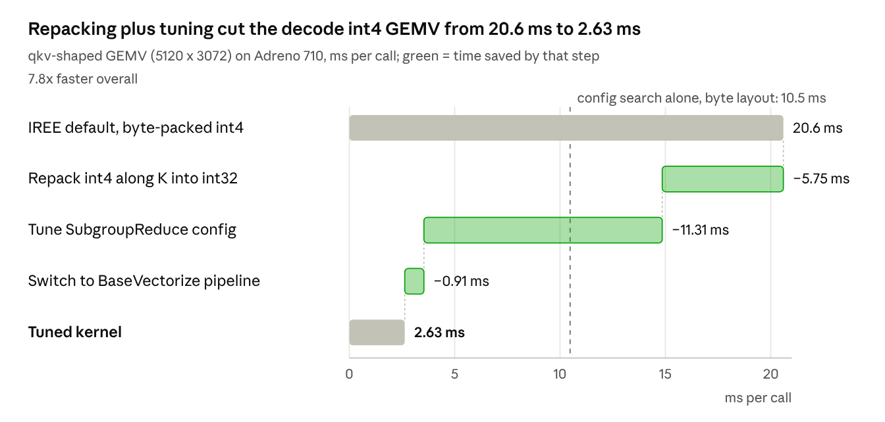

# Bringing PyTorch LLMs to a Mid-Range Adreno GPU with IREE

*October 12, 2026 · Aditya*

## TL;DR

I took Hugging Face PyTorch models down an MLIR path (torch-mlir to IREE to SPIR-V to Vulkan) onto the Adreno 710 GPU of a mid-range Android phone, over adb on Wi-Fi. DistilBERT now matches PyTorch to 2.4e-6 on the GPU. A Llama 3.2 3B int4 pipeline is built and validated on the host, and the key decode kernel is 7.8x faster after tuning.

The post follows the work in order, with the code inline: installing the toolchain, the first end-to-end run, how the LLM pipeline is implemented, then the tuners and what they bought. Getting there took fifteen fixes, two of them in GPU drivers and one in IREE's runtime. They're collected in one table, *Fixes along the way*, each linking to its write-up in the [repo](docs/BUGS.md).

Three lessons carried the most weight:

1. On a phone, check correctness before speed. The driver and runtime bugs gave plausible wrong answers, not crashes.
2. For genAI, how the model is written at export time beats kernel tile sizes. Repacking int4 weights unlocked a 4x kernel win that no config search could reach.
3. A tuner for this stack must search across IREE pipelines, treat compile time as a constraint, and interleave measurements to beat thermal noise.

## The setup

The target is a deliberately ordinary phone: a moto g stylus 5G (2024), driven from a Mac over adb on Wi-Fi.

| Property | Value |
| --- | --- |
| SoC / GPU | Snapdragon 7s Gen 2 (SM6450) / Adreno 710 |
| OS | Android 14, December 2024 patch, bootloader locked |
| RAM | 7.6 GB total, about 3.3 GB available to an app |
| Vendor Vulkan driver | 1.1.128, shader compiler EV031.36.08.28 (January 2024) |
| Compute limits | subgroup 64, 32 KB shared memory, 128 MB max storage-buffer binding |
| Missing features | shaderInt64, integer dot product, cooperative matrix |

The lowering path has five stages:

1. **Capture:** `torch.export` through iree-turbine, with int64 buffers cast to int32 and masks precomputed.
2. **Import:** torch-mlir's FX importer produces the torch dialect, then linalg on tensors.
3. **Global optimization and dispatch formation:** IREE fuses ops into dispatch regions (kernels) and plans buffers in its Stream dialect.
4. **Codegen:** each dispatch gets a SPIR-V pipeline (SubgroupReduce, BaseVectorize and others) chosen from a GPU target description.
5. **Runtime:** IREE's HAL runs the SPIR-V through Vulkan, from `iree-run-module` or a small C runner of my own.

I chose IREE because it already covers the whole path: import, fusion, a Vulkan backend, an Android runtime, and hooks to dump and substitute per-kernel configurations. Those hooks became the backbone of the tuner.

## Step 1: Install the toolchain

Everything installs on the Mac; the phone only gets files under `/data/local/tmp`, and nothing on its system partition changes. All commands below are scripts in the [companion repo](README.md).

Host tools come from Homebrew, and Python from two venvs. Two IREE versions are needed because IREE 3.12 refuses Vulkan 1.1 devices ([B1](docs/BUGS.md#b1-iree-312-refuses-vulkan-11-devices)): 3.11 pairs with the stock Qualcomm driver, 3.12 with Turnip. A compiler and runtime must always be the same version.

```bash
brew install cmake ninja meson bison uv
brew install --cask android-ndk android-platform-tools

# .venv = IREE 3.11, .venv-iree312 = IREE 3.12; both: torch 2.14.1, transformers 5.19.0, iree-turbine 3.9.0
scripts/setup_venvs.sh

# pinned sources: IREE v3.11.0 and v3.12.0 (runtime submodules + our barrier patch), Mesa main@745709a
scripts/fetch_deps.sh
```

The IREE compiler runs on the Mac from the pip wheel; only the runtime is cross-compiled for the phone. The wheel already ships the two host tools the cross-build needs (`iree-flatcc-cli`, `iree-c-embed-data`), so pointing `IREE_HOST_BIN_DIR` at it saves a host build. This is the core of [`build_android_runtime.sh`](scripts/build_android_runtime.sh):

```bash
cmake -G Ninja -S "$SRC" -B "$ROOT/build/iree${SUFFIX}-android" \
  -DCMAKE_TOOLCHAIN_FILE="$ANDROID_NDK/build/cmake/android.toolchain.cmake" \
  -DANDROID_ABI=arm64-v8a -DANDROID_PLATFORM=android-29 -DCMAKE_BUILD_TYPE=Release \
  -DIREE_HOST_BIN_DIR="$VENV/lib/python3.12/site-packages/iree/_runtime_libs" \
  -DIREE_BUILD_COMPILER=OFF -DIREE_BUILD_TESTS=OFF -DIREE_BUILD_SAMPLES=OFF \
  -DIREE_HAL_DRIVER_DEFAULTS=OFF -DIREE_HAL_DRIVER_VULKAN=ON \
  -DIREE_HAL_DRIVER_LOCAL_SYNC=ON -DIREE_HAL_DRIVER_LOCAL_TASK=ON
cmake --build "$ROOT/build/iree${SUFFIX}-android" --target iree-run-module iree-benchmark-module
```

The last install is the GPU driver. [`build_turnip.sh`](scripts/build_turnip.sh) cross-compiles Mesa's Turnip with the NDK and builds a small `libvulkan.so` shim (Step 3 shows how it works). With `--push` it copies both to the phone and runs a capability check:

```bash
IREE_VERSION=3.12 scripts/build_android_runtime.sh
IREE_VERSION=3.12 scripts/build_runner.sh
scripts/build_turnip.sh --push
adb push build/iree312-android/tools/iree-run-module build/runner312-android/llm-runner /data/local/tmp/iree312/
```

```text
device: Turnip Adreno (TM) 710
driver: turnip Mesa driver Mesa 26.3.0-devel (git-745709a000)
api: 1.4.363
1.3: synchronization2=1 subgroupSizeControl=1 computeFullSubgroups=1 shaderIntegerDotProduct=1
```

The stock driver reports Vulkan 1.1.128 with none of those 1.3 features. Turnip only exists for Adreno 710 on Mesa `main`, not in any release yet.

## Step 2: The first end-to-end path

The first model to run end to end on the phone's GPU was DistilBERT SST-2 (67M parameters), and its logits match PyTorch to 3.7e-6. The path is three commands: export, compile, run and compare.

```bash
.venv/bin/python scripts/export_hf.py --out models/distilbert-sst2            # torch.export -> torch-dialect MLIR
scripts/compile.sh models/distilbert-sst2 adreno710                           # iree-compile -> .vmfb
.venv/bin/python scripts/check.py models/distilbert-sst2 adreno710 --device   # adb push, run, compare
```

**Export.** [`export_hf.py`](scripts/export_hf.py) wraps the Hugging Face model so that `torch.export` sees only ops IREE can lower. Two changes did that. Int64 buffers and inputs become int32, because the GPU has no 64-bit integers and IREE's demotion flag can't retype weight blobs ([B2](docs/BUGS.md#b2-no-64-bit-integers-and-input-demotion-cannot-retype-weights)). And the attention mask is built by hand ([B3](docs/BUGS.md#b3-transformers-5-mask-builder-does-not-lower), [B4](docs/BUGS.md#b4-sdpa-mask-is-not-broadcast)):

```python
for mod in model.modules():                      # no shaderInt64 on the GPU
    for k, buf in list(mod._buffers.items()):
        if buf is not None and buf.dtype == torch.int64:
            mod._buffers[k] = buf.to(torch.int32)

class LogitsOnly(torch.nn.Module):
    def forward(self, input_ids, attention_mask):
        b, s = attention_mask.shape
        mask = (1.0 - attention_mask[:, None, None, :].to(self.dtype)) * -1e4
        mask = mask.expand(b, 1, s, s)           # 4D mask: HF skips its vmap mask builder
        return self.model(input_ids=input_ids, attention_mask=mask).logits

aot.export(LogitsOnly(model), args=(input_ids, attention_mask)).save_mlir("model.mlir")
```

**Compile.** Under [`compile.sh`](scripts/compile.sh) is one `iree-compile` call. The torch dialect goes in, and a `.vmfb` comes out holding host bytecode plus one SPIR-V kernel per dispatch:

```bash
iree-compile model.mlir --iree-input-type=torch --iree-input-demote-i64-to-i32 \
    --iree-hal-target-device=vulkan --iree-vulkan-target=adreno -o model.vmfb
```

That first build ran, with the right labels and wrong logits, the first of several GPU-only surprises. IREE's generic `adreno` target lets reductions use 3 subgroups, which the Qualcomm shader compiler gets wrong ([B6](docs/BUGS.md#b6-qualcomm-shader-compiler-breaks-non-power-of-two-subgroup-reductions)). The `adreno710` target in [`targets/`](targets) describes this exact GPU instead, and `compile.sh` injects it as `hal.device.targets` in place of the generic flag:

```text
wgp = <compute = fp32|fp16|int32|int16|int8, storage = b32|b16|b8, subgroup = shuffle|arithmetic,
       dot = none, subgroup_size_choices = [64], max_thread_count_per_workgroup = 128, ...>
```

**Run and compare.** [`check.py`](scripts/check.py) pushes the module and inputs and runs IREE's stock tool on the phone, then pulls the output back:

```bash
adb shell "cd /data/local/tmp/iree/distilbert-sst2 && /data/local/tmp/iree/iree-run-module \
    --device=vulkan --module=adreno710.vmfb --function=main \
    --input=@input_ids.i32.npy --input=@attention_mask.i32.npy --output=@out_adreno710.npy"
```

```text
[adreno710] max|Δlogit|=3.695e-06  mean=2.295e-06
  OK  torch=POSITIVE:0.9478  iree=POSITIVE:0.9478  "This phone's GPU is surprisingly fast for its price."
  OK  torch=NEGATIVE:0.9997  iree=NEGATIVE:0.9997  'The battery died after an hour and support never replied.'
```

The same flow covers the phone's CPU (`android-cpu`) and Turnip (`IREE_VERSION=3.12 ADRENO_DRIVER=turnip`, target `turnip710`). Comparing all three against PyTorch separated model bugs from compiler bugs from driver bugs at every step.

## Step 3: How the LLM pipeline is implemented

Llama 3.2 3B has to fit in about 3.3 GB of free RAM, so the pipeline is built around int4 weights (1.81 GB) and a 4K fp16 KV cache (448 MiB). Rather than fight the exporter, I wrote a ~250-line Llama in PyTorch, [`llama_q4.py`](scripts/llm/llama_q4.py). It loads the Hugging Face weights and is shaped for IREE: fused q/k/v and gate/up projections, fp32 math with an fp16 KV cache ([B7](docs/BUGS.md#b7-fp16-reductions-overflow-on-the-gpu)), and a vocabulary split into four chunks so that no tensor bound to a kernel exceeds the GPU's 128 MB limit.

**Weights.** Each weight matrix is quantized to symmetric int4 in groups of 32, then packed along K into int32 words of 8 nibbles. Decode multiplies one token by every matrix, so its projections are written as a single expression that IREE fuses into one kernel. It unpacks the nibbles in registers and never materializes the fp32 weights ([B12](docs/BUGS.md#b12-int4-dequant-not-fused-into-the-decode-matmul)):

```python
def _gemv_fused(self, x):                      # decode, M = 1
    q = self.qweight.reshape(n, kg, wpg)       # int32 words: 8 nibbles each
    x4 = x.reshape(kg, wpg, 8)
    s = self.scales.to(torch.float32)[:, :, None]
    acc = None
    for b in range(8):                         # scalar shifts, scale folded into every term
        term = x4[:, :, b] * ((((q >> (4 * b)) & 15).to(torch.float32) - 8.0) * s)
        acc = term if acc is None else acc + term
    return acc.sum(dim=(1, 2)).reshape(1, n)   # single-input sum -> IREE fuses the whole chain
```

**One step function.** Prefill and decode share `LlamaQ4.step(tokens, start, last, caches, L)`. The KV cache arrives as function arguments shaped `[4096, 8, 128]` and is updated in place, position-first ([B10](docs/BUGS.md#b10-index_copy_-on-a-non-leading-dim-does-not-lower)). Attention reads only the first `L` slots:

```python
k_cache.index_copy_(0, pos, k.to(k_cache.dtype))     # in place: IREE writes the caller's buffer
v_cache.index_copy_(0, pos, v.to(v_cache.dtype))
K = k_cache[:L].to(torch.float32).permute(1, 2, 0)    # attend over the bucket, not all 4096
V = v_cache[:L].to(torch.float32).permute(1, 0, 2)
qg = q.reshape(C, n_kv, g, hd).permute(1, 2, 0, 3).reshape(n_kv, g * C, hd)  # GQA, no K/V copies
p = torch.softmax(torch.where(mask, torch.bmm(qg, K) * scale, -1e30), -1)
```

**Static entry points.** IREE prefers static shapes, so [`export_llama.py`](scripts/llm/export_llama.py) exports one function per phase and KV bucket into a single module. The weights go to an external `.irpa` parameter file:

```python
for L in [256, 512, 1024, 2048, 4096]:
    add(f"prefill_c128_l{L}", C=128, L=L)   # (tokens[1,128], start, last, k0, v0, ... k27, v27) -> next token
    add(f"decode_l{L}",       C=1,   L=L)
aot.externalize_module_parameters(model, external_scope="model")
aot.save_module_parameters("weights.irpa", model)
```

**The runner is the scheduler.** IREE's `iree-run-module` forgets state between invocations, so a small C program, [`llm_runner.c`](runner/llm_runner.c), drives generation on the phone. It allocates the 56 cache buffers once, splits the prompt into 128-token chunks, and for each step calls the smallest bucket that fits:

```c
for (int start = 0; start < n_prompt; start += C) {          // chunked prefill
  int L = pick_bucket(buckets, nb, start + C, use_max);
  snprintf(fn, sizeof(fn), "prefill_c%d_l%d", C, L);
  IREE_RETURN_IF_ERROR(call_step(r, fn, buf, C, start, n - 1, &next));
}
while (n_gen < FLAG_max_new_tokens) {                        // decode, one token per call
  int L = pick_bucket(buckets, nb, pos + 1, use_max);         // grows with the context
  snprintf(fn, sizeof(fn), "decode_l%d", L);
  IREE_RETURN_IF_ERROR(call_step(r, fn, &next, 1, pos, 0, &next));
  generated[n_gen++] = next; ++pos;
}
```

**The driver shim.** Turnip built for Android exports only the HAL module `HMI`. [`vulkan_shim.c`](runner/turnip/vulkan_shim.c), compiled as `libvulkan.so`, does what Android's loader would do. It also pins the subgroup size that IREE's kernels assume ([B8](docs/BUGS.md#b8-turnip-runs-compute-128-wide-unless-asked)):

```c
hwvulkan_module_t* hmi = (hwvulkan_module_t*)dlsym(lib, HAL_MODULE_INFO_SYM_AS_STR);
hmi->common.methods->open(&hmi->common, HWVULKAN_DEVICE_0, &dev);  // the "vk0" device
g_dev = (hwvulkan_device_t*)dev;

vkGetInstanceProcAddr(VkInstance instance, const char* name) {      // what IREE dlsym()s
  return g_dev->GetInstanceProcAddr(instance, name);                // (+ wrappers below)
}
// wrapped vkCreateComputePipelines: pipelines without a size get 64-wide subgroups
req[i].requiredSubgroupSize = g_subgroup_size;
```

The processes that opt in run with `LD_LIBRARY_PATH=/data/local/tmp/turnip`; everything else on the phone keeps the vendor driver.

**Validation.** [`test_tiny.py`](scripts/llm/test_tiny.py) compares `LlamaQ4` with Hugging Face's `LlamaForCausalLM` on a random 2-layer config with the 3B model's structure. Logits match to 5e-5, and the compiled module run by the C runner on Turnip reproduces all 10 reference tokens. On the real 3B weights, eager int4 answers a test prompt with "Mobile GPUs are memory-bandwidth bound because they typically have limited memory bandwidth and capacity".

## Fixes along the way

Fifteen fixes were needed before the pipeline above produced correct numbers; two came from a driver, one from IREE's runtime, the rest from gaps between PyTorch, torch-mlir and IREE. Each links to its symptom, cause and fix in [`docs/BUGS.md`](docs/BUGS.md).

| Bug | Layer | Fix |
| --- | --- | --- |
| [B1](docs/BUGS.md#b1-iree-312-refuses-vulkan-11-devices) IREE 3.12 refuses Vulkan 1.1 | IREE runtime | IREE 3.11 on the stock driver; 3.12 on Turnip |
| [B2](docs/BUGS.md#b2-no-64-bit-integers-and-input-demotion-cannot-retype-weights) No int64; demotion can't retype weights | export | cast to int32 in PyTorch |
| [B3](docs/BUGS.md#b3-transformers-5-mask-builder-does-not-lower) HF mask builder doesn't lower | export | precomputed 4D mask |
| [B4](docs/BUGS.md#b4-sdpa-mask-is-not-broadcast) SDPA mask not broadcast | torch-mlir | expand to `[B,1,S,S]` |
| [B5](docs/BUGS.md#b5-no-spir-v-codegen-for-fused-attention) No SPIR-V fused attention; decomposition gives NaN | IREE codegen | eager attention |
| [B6](docs/BUGS.md#b6-qualcomm-shader-compiler-breaks-non-power-of-two-subgroup-reductions) 3/5/6-subgroup reductions wrong | Qualcomm driver | target caps threads at 128 |
| [B7](docs/BUGS.md#b7-fp16-reductions-overflow-on-the-gpu) fp16 reductions overflow | numerics | fp32 norms and softmax |
| [B8](docs/BUGS.md#b8-turnip-runs-compute-128-wide-unless-asked) Turnip runs 128-wide waves | Turnip | shim pins subgroup size 64 |
| [B9](docs/BUGS.md#b9-iree-execution-barriers-miss-transfer-accesses) Barriers miss copies; decode corrupted | IREE runtime | patch for 3.11 and 3.12 |
| [B10](docs/BUGS.md#b10-index_copy_-on-a-non-leading-dim-does-not-lower) `index_copy_` on dim > 0 | torch-mlir | position-first KV cache |
| [B11](docs/BUGS.md#b11-bool--and-tensor-by-tensor-shifts-do-not-lower) Bool `&`, tensor `>>` | torch-mlir | clamp-compare, scalar shifts |
| [B12](docs/BUGS.md#b12-int4-dequant-not-fused-into-the-decode-matmul) int4 dequant not fused | export / fusion | fused GEMV over int32 words |
| [B13](docs/BUGS.md#b13-tensor-literals-break-dispatch-benchmarks) Literals break kernel benchmarks | export | constants from `arange` |
| [B14](docs/BUGS.md#b14-const-expr-hoisting-doubles-int4-weight-memory) Hoisting doubles weight memory | IREE flags | hoisting off for LLMs |
| [B15](docs/BUGS.md#b15-mesa-cross-build-drops-its-own-warning-flags) Mesa build drops its warning flags | build | `-static-libstdc++` as a link arg |

Three are still [open](docs/BUGS.md#open): fp16 DistilBERT crashes Turnip, IREE 3.12 costs more per dispatch, and some kernels compile very slowly.

## Step 4: The tuners we bring in

One global autotuner can't serve an LLM. Prefill is a compute-bound GEMM; decode is a memory-bound GEMV per token; context length moves from 1 to 4K; and every layer of this stack had a bug that returned wrong numbers silently. So the tuner is a stack of small tuners. Each one scores its candidates on the phone and rejects any candidate whose output differs from the reference. The full design is in [`docs/TUNER_PLAN.md`](docs/TUNER_PLAN.md); these four are implemented:

| Tuner | Changes | Scored by | Code |
| --- | --- | --- | --- |
| Export formulation | how ops and weights are written before IREE sees them | kernels per token, bytes moved, compile time | [`llama_q4.py`](scripts/llm/llama_q4.py) |
| Kernel configs | pipeline, workgroup size and tiles of one dispatch | kernel time on the GPU | [`kernel_tuner.py`](scripts/tune/kernel_tuner.py) |
| Compile flags | fusion, memoization, partitioning, opt level | end-to-end prefill and decode tok/s | [`flag_tuner.py`](scripts/tune/flag_tuner.py) |
| Runtime scheduler | KV bucket and chunk per step | time to first token, decode tok/s | [`llm_runner.c`](runner/llm_runner.c) |

**Kernel tuner.** IREE can dump every dispatch as a standalone benchmark after it has picked a configuration (`--iree-hal-dump-executable-benchmarks-to`). It can also take configurations back in (`--iree-hal-substitute-executable-configurations-from`). The tuner works between those two hooks. It parses a kernel's `translation_info` and `lowering_config`, generates candidates for the same pipeline and for others, and pushes each candidate's compile to the phone to be timed:

```python
# SubgroupReduce candidates (decode GEMVs): threads per workgroup x reduction tile x outputs per workgroup
for h, rows, kt, wg in itertools.product(h_opts, rows_opts, k_tiles, [64, 128, 256, 512]):
    if (kt * inner) % wg or (kt * inner) // wg > 16:   # prune: divisibility, work per thread
        continue
    yield f"sgr_h{h}_rows{rows}_k{kt}_wg{wg}", new_translation_info, new_lowering_config
# ...and the same kernel on another pipeline: BaseVectorize, several outputs per thread
base_ti = re.sub(r"spirv_pipeline<\w+>", "spirv_pipeline<BaseVectorize>", ti)
```

Timing batches the dispatch inside one submission, because a single submit-and-wait on this phone costs 1 to 3 ms, more than many kernels themselves:

```python
r = sh(["iree-compile", candidate_mlir, "-o", vmfb])                 # seconds, not minutes
sh(["adb", "push", vmfb, f"{DEV_DIR}/{tag}.vmfb"])
out = sh(["adb", "shell", f"... iree-benchmark-module --device=vulkan --module={tag}.vmfb "
                          f"--batch_size={a.batch} --benchmark_repetitions={a.reps} ..."]).stdout
```

**Flag tuner.** A greedy coordinate search over IREE's global switches. Each round tries every remaining flag on top of the current best, keeps the winner only if it gains more than 2%, and throws out any build whose greedy tokens change:

```python
BASE = ["--iree-opt-const-expr-hoisting=false"]          # keep int4 weights packed (B14)
TOGGLES = {"memoize": ["--iree-hal-memoization=true"],
           "hfuse": ["--iree-dispatch-creation-enable-fuse-horizontal-contractions=true"],
           "aggr_fuse": ["--iree-dispatch-creation-enable-aggressive-fusion=true"],
           "concurrency": ["--iree-stream-partitioning-favor=max-concurrency"], ...}
for t in sorted(remaining):
    r = run(set(best["toggles"]) | {t})
    if r["ok"] and r["tokens"] != ref_tokens:              # correctness guard
        continue
```

**Scheduler.** The runner from Step 3 has two policies: `bucketed` picks the smallest KV bucket that fits each step, while `max` always uses 4K, as a single static graph would. [`bench.py`](scripts/llm/bench.py) runs both across prose, code and chat prompts at 256 to 4K context:

```bash
.venv-iree312/bin/python scripts/llm/bench.py --vmfb turnip710.iree312.vmfb \
    --ctx 256 512 1024 2048 4096 --kinds prose code chat --schedule bucketed max
```

## Results: what tuning bought

The first kernel through the tuner was decode's int4 GEMV, the qkv projection, and it got 7.8x faster. Config search did most of the work, but only after the weights were repacked.



*Measured on the phone with iree-benchmark-module (Turnip, IREE 3.12): median of 3 runs, 20 dispatches per submission.*

On the original layout, int4 nibbles from two rows shared each byte. The kernel tuner tried 200 configs and stopped at 10.5 ms. IREE's `SubgroupReduce` pipeline only works with one output per workgroup, and every config with wider per-thread vectors either failed to legalize `vector<8xi8>` constants or crashed the GPU. The generated SPIR-V showed why the kernel was slow: two scalar `i8` loads per thread per step.

Repacking int4 along K into int32 words (8 nibbles each) changed what the compiler could do. Written as one expression whose scale is folded into each term, the GEMV became a single fused kernel that loads 32-bit words; folding the scale matters because a two-input multiply-and-sum is treated as a contraction and blocks fusion. That kernel then tuned to 3.54 ms on `SubgroupReduce`, and a cross-pipeline search found 2.63 ms on `BaseVectorize`, with two outputs per thread and 128 threads.

Three more findings shaped the plan:

- **Per-dispatch cost is first-order.** A tiny kernel costs 0.54 ms per dispatch on IREE 3.11 with Turnip, and 1.23 ms on 3.12. At a few hundred dispatches per token, fusion can matter as much as tiles.
- **Compile time is a constraint.** Some default configs took over 2 minutes per kernel, and an 11-entry-point 3B module took over 40 minutes. The tuner times standalone kernel benchmarks (seconds per candidate) and caps compile time.
- **Noise is real.** The same default kernel measured 12.2 ms in one session and 14.85 ms in another. Comparisons must interleave runs and use medians.

## What's next, and how to reproduce

End-to-end Llama 3B tok/s on the phone is the next milestone. The pieces exist, but this post stops before that number. The remaining steps, in order:

1. Compile the 3B model with the repacked int4 layout and check that the phone reproduces the 16 reference tokens.
2. Measure the baseline: IREE defaults with the always-4K schedule, across prose, code and chat prompts at 256, 512, 1K, 2K and 4K context.
3. Apply the tuned configs to every decode GEMV shape (qkv, o, gate/up, down, LM head), then run the flag tuner and the bucketed schedule.
4. Compare IREE 3.11 and 3.12 end to end. On Turnip, a tiny kernel costs 0.54 ms per dispatch on 3.11's HAL and 1.23 ms on 3.12's, which matters at a few hundred dispatches per token.
5. Prefill: fp16 compute, a real attention kernel, larger chunks.
6. Upstream: the barrier patch, and Adreno-aware defaults in IREE's SPIR-V kernel configuration.

The companion repository, [adityaGoCT/iree-adreno-genai-tuner](https://github.com/adityaGoCT/iree-adreno-genai-tuner), holds everything needed to repeat this on another Adreno phone: the export, compile and check scripts, the on-device C runner, the Turnip cross file and shim, the IREE patch, the target descriptions, the probes, and both tuners. Weights are never committed; the export script quantizes them from your own Hugging Face download.
